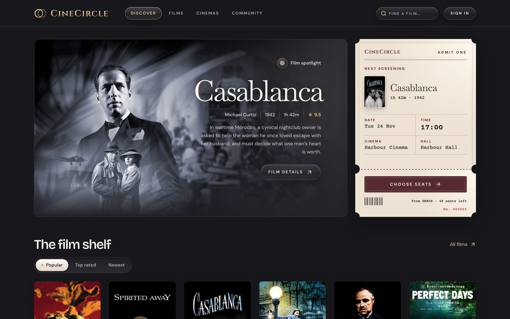
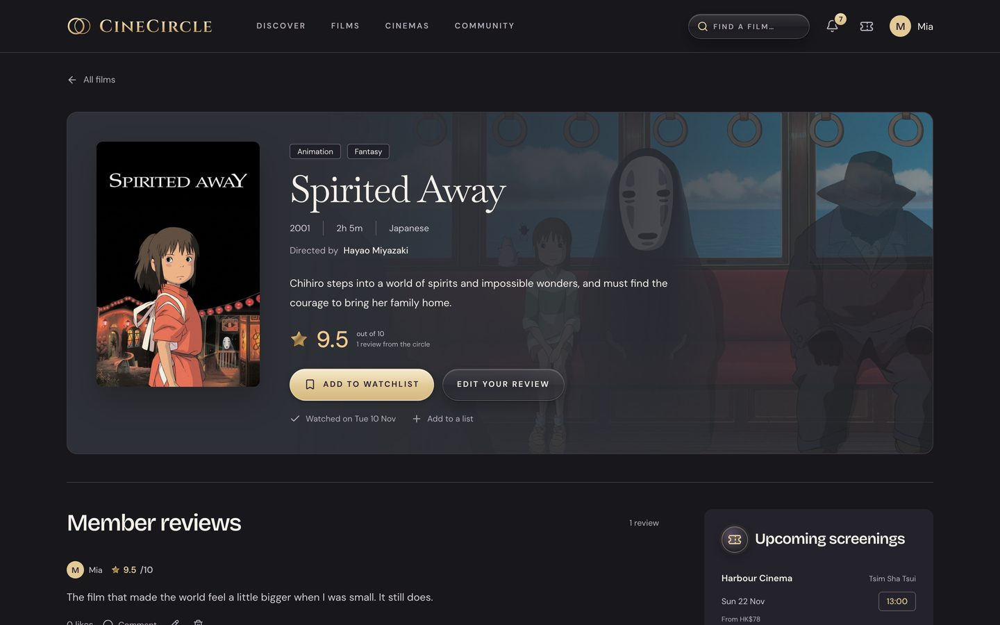
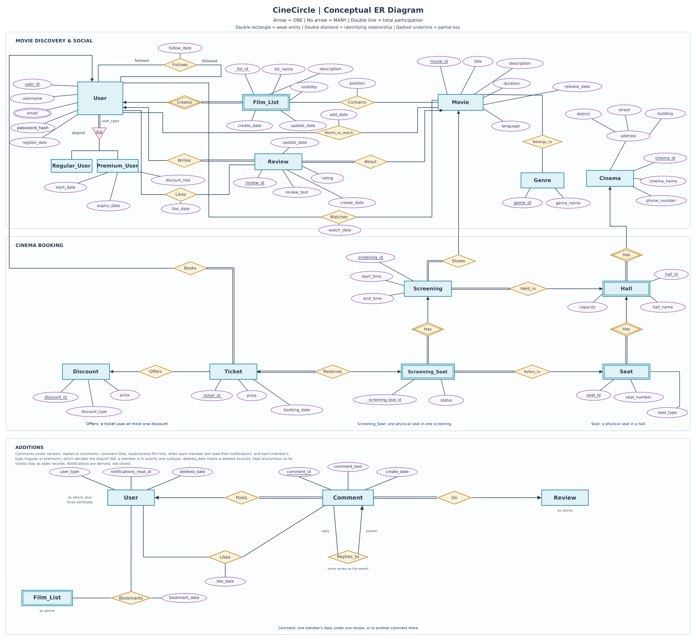
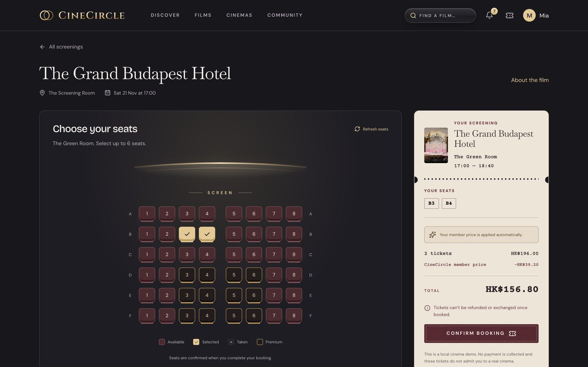
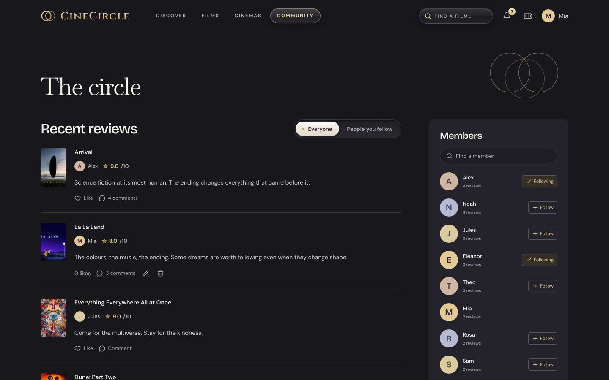

# CineCircle

**A movie community and cinema booking website built on a 25-table MySQL database.**
COMP3278 Introduction to Database Management Systems, final project.



Members discover films, rate and review them, talk about the reviews, keep watchlists and film lists, follow each other, and book cinema seats, with premium members paying less. Every one of these actions is a create, read, update or delete on MySQL, written as parameterised SQL in the Express server, with transactions wherever several rows must change together.

**Contents**

1. [What the app does](#1-what-the-app-does)
2. [How it is built](#2-how-it-is-built)
3. [Database design](#3-database-design)
4. [Key SQL statements](#4-key-sql-statements)
5. [Install and run](#5-install-and-run)
6. [Database setup, configuration and initial data](#6-database-setup-configuration-and-initial-data)
7. [A tour for the demo](#7-a-tour-for-the-demo)
8. [Tests](#8-tests)
9. [Project structure](#9-project-structure)

**Quick start** (needs only [Docker Desktop](https://www.docker.com/products/docker-desktop/)): open a terminal in this folder, run `docker compose up --build`, then open **http://localhost:3001** and choose **Sign in → Continue as Mia**. The database is created and filled with demo data automatically. Other ways to run it are in [section 5](#5-install-and-run).

---

## 1. What the app does

| Area               | What a member can do                                                                                                                                                                                                |
| ------------------ | ------------------------------------------------------------------------------------------------------------------------------------------------------------------------------------------------------------------- |
| Discover films     | Search 22 films by title, filter by genre, sort by rating, popularity, release date or title; open a film's synopsis, runtime, language, circle rating, reviews and upcoming screenings.                            |
| Reviews            | Rate a film from 0 to 10 and write a review (one per film), edit or delete it, and like other members' reviews.                                                                                                     |
| Conversations      | Comment on any review, reply to any comment at any depth (shown two layers at a time), like comments, and remove your own comments or any comment under your own review. Replies from people you follow come first. |
| Keeping track      | Keep a watchlist and record the date you watched a film.                                                                                                                                                            |
| Film lists         | Create public or private lists, add, remove and reorder films, rename or delete lists, and bookmark other members' public lists. Community lists are ranked by bookmarks.                                           |
| People             | Find members by name, follow and unfollow them, see who follows whom, and switch the review feed to people you follow.                                                                                              |
| Cinema booking     | Browse Hong Kong cinemas and showtimes, pick up to six seats on a live seat map, see the server-calculated price with offers, and book; tickets appear in your history. Tickets cannot be refunded.                 |
| Premium membership | Choose premium when registering, or upgrade from your corner or at checkout: 20% off for 12 months, renewable. Members are always exactly one of regular or premium.                                                |
| Notifications      | A bell gathers comments, replies, likes, new reviews by people you follow, new followers, bookings, a reminder an hour before a screening and a week before a membership ends.                                      |
| Account            | Change username, email or password (names and emails already in use are refused), or delete the account after two confirmations. Tickets stay as anonymous sales records.                                           |



### CRUD at a glance

Each row is a table the app writes to, and where in the app each operation happens.

| Table(s)                                      | Create                                  | Read                                       | Update                                | Delete                                              |
| --------------------------------------------- | --------------------------------------- | ------------------------------------------ | ------------------------------------- | --------------------------------------------------- |
| `users`, `user_email`, subtypes               | Register                                | Sign in, profiles, member search           | Username, email, password; go premium | Delete account (anonymised, see 3.4)                |
| `review`                                      | Write a review                          | Film page, Community feed, profiles        | Edit rating and text                  | Delete review (with its likes and comments)         |
| `review_comment`, `comment_like`              | Comment, reply, like                    | Conversation under a review                | –                                     | Remove a comment and its replies; unlike            |
| `film_list`, `film_list_movie`                | New list (optionally with a first film) | My lists, list page, Community collections | Rename, visibility, add film, reorder | Remove a film; delete the list                      |
| `list_bookmark`, `follows`                    | Bookmark a list, follow a member        | Saved tab, ranking, follower lists, feed   | –                                     | Remove bookmark, unfollow                           |
| `wants_to_watch`, `watches`                   | Add to watchlist, mark watched          | Film page, My circle                       | Change the watched date               | Remove from watchlist / watched                     |
| `ticket`, `ticket_discount`, `screening_seat` | Book seats                              | Seat map, My tickets, notifications        | Seat status becomes `booked`          | – (non-refundable; kept when an account is deleted) |

## 2. How it is built

```
Browser (Vue 3 + Vite)  ──JSON over /api──▶  Express 5 server  ──mysql2 pool──▶  MySQL 8
  pages and components                       routes write the SQL               25 tables, PK/FK/UNIQUE/CHECK
```

- **Frontend:** Vue 3 single-page app (`src/`). It never sees the database; it calls a JSON API.
- **Backend:** Express 5 (`server/`). Every route builds its SQL with `?` placeholders through `mysql2`, so user input is never pasted into SQL. Writes that touch several rows run inside `transaction()` (`server/db.mjs`): begin, run, commit, or roll back on any error.
- **Database:** MySQL 8 (8.0.16 or newer; Docker uses 8.4), InnoDB, `utf8mb4`, Hong Kong time (`+08:00`). The schema is `CineCircle_MySQL.sql`.
- **Sessions:** a signed, HttpOnly cookie; passwords are stored as salted scrypt hashes.

## 3. Database design

### 3.1 ER diagram



[`CineCircle_ER.png`](CineCircle_ER.png) uses arrows for "one", plain lines for "many", double lines for total participation, double rectangles for weak entities and double diamonds for identifying relationships. The diagram has three panels:

- **Movie discovery and social.** **User** writes **Reviews** About a **Movie**, Likes reviews, Follows other users (follower/followed), keeps Wants_to_watch and Watches records, and Creates **Film_Lists**. A Film_List Contains movies, with a `position`. A Movie Belongs_to **Genres**. User specialises into **Regular_User** and **Premium_User** (disjoint and total). Premium_User has `start_date`, `expiry_date` and `discount_rate`. Email is multivalued.
- **Cinema booking.** A **Cinema** (composite address) Has **Halls**, a Hall Has **Seats**, and both are weak entities. A **Screening** Shows a movie and is Held_in one hall. **Screening_Seat** is a weak entity of Screening: one physical seat in one screening, with a `status`. A **Ticket** is Booked by one user, Reserves exactly one screening seat, and is Offered at most one **Discount**.
- **Additions.** A **Comment** is Posted by one user On one review and may be a reply to one parent comment (Replies_to, which stays within the same review). Users Like comments and Bookmark other users' film lists. User also gains `user_type` (the attribute that decides the ISA), `notifications_read_at` and `deleted_date`.

### 3.2 From the ER diagram to tables

| ER construct                                | Tables and keys                                                                                                                                       |
| ------------------------------------------- | ----------------------------------------------------------------------------------------------------------------------------------------------------- |
| Strong entities                             | `users`, `movie`, `genre`, `review`, `cinema`, `screening`, `ticket`, `discount`, `review_comment`, each with a surrogate `…_id` key                  |
| Weak entities                               | `film_list (user_id, list_id)`, `hall (cinema_id, hall_id)`, `seat (cinema_id, hall_id, seat_id)`, `screening_seat (screening_id, screening_seat_id)` |
| Many-to-many relationships                  | `movie_genre`, `film_list_movie` (+ `position`), `follows`, `wants_to_watch`, `watches`, `review_like`, `comment_like`, `list_bookmark`               |
| Many-to-one relationships                   | Foreign keys on the "many" side: `review.user_id`, `review.movie_id`, `ticket.user_id`, `screening.movie_id`, `review_comment.parent_comment_id`, …   |
| Offers (a ticket uses at most one discount) | `ticket_discount` with `UNIQUE (ticket_id)`                                                                                                           |
| ISA (disjoint, total)                       | `regular_user`, `premium_user`, both keyed by `user_id`, each tied to `users (user_id, user_type)`                                                    |
| Multivalued `email`                         | `user_email (user_id, email)`, with `email` unique across users                                                                                       |
| Composite `address`                         | `district`, `street`, `building` columns on `cinema`                                                                                                  |

The 25 tables, by area:

- **Members:** `users`, `user_email`, `regular_user`, `premium_user`, `follows`
- **Films:** `movie`, `genre`, `movie_genre`, `wants_to_watch`, `watches`
- **Reviews and conversations:** `review`, `review_like`, `review_comment`, `comment_like`
- **Film lists:** `film_list`, `film_list_movie`, `list_bookmark`
- **Cinemas and booking:** `cinema`, `hall`, `seat`, `screening`, `screening_seat`, `ticket`, `discount`, `ticket_discount`

### 3.3 Rules the database enforces

| Rule                                                 | How                                                                                                                                           |
| ---------------------------------------------------- | --------------------------------------------------------------------------------------------------------------------------------------------- |
| Usernames and emails are unique                      | `UNIQUE (username)`, `UNIQUE (email)` (case-insensitive collation)                                                                            |
| One review per member per film; ratings 0–10         | `UNIQUE (user_id, movie_id)`, `CHECK (rating BETWEEN 0 AND 10)`                                                                               |
| No following yourself; no bookmarking your own list  | `CHECK (follower_id <> followed_id)`, `CHECK (user_id <> owner_id)`                                                                           |
| A seat number appears once per hall                  | `UNIQUE (cinema_id, hall_id, seat_number)`                                                                                                    |
| A screening seat belongs to the screening's own hall | composite FKs `(screening_id, cinema_id, hall_id)` → `screening` and `(cinema_id, hall_id, seat_id)` → `seat`                                 |
| A screening seat is sold at most once                | `UNIQUE (screening_id, screening_seat_id)` on `ticket`                                                                                        |
| A ticket uses at most one discount                   | `UNIQUE (ticket_id)` on `ticket_discount`                                                                                                     |
| A reply stays under the same review as its parent    | FK `(parent_comment_id, review_id)` → `review_comment (comment_id, review_id)`                                                                |
| A member is regular or premium, never both           | `users.user_type` + `UNIQUE (user_id, user_type)`; each subtype has a fixed `user_type` (CHECK) and FK `(user_id, user_type)` → `users`       |
| Valid values                                         | CHECKs on statuses, visibility, positive durations, capacities and positions, non-negative prices, end after start, membership dates and rate |

### 3.4 Design decisions worth knowing

- **Disjoint ISA without "delete then add" risk.** Upgrading to premium is one transaction: lock the member, delete the `regular_user` row, change `user_type`, insert the `premium_user` row. Nothing else refers to the subtype tables, so reviews, lists and tickets are untouched. Ended memberships move back the same way (at server start and hourly).
- **Owner-local list IDs.** A list is identified by `(user_id, list_id)`. A new `list_id` is `MAX(list_id)+1` for that owner, computed while the owner's row is locked, so two simultaneous "New list" requests cannot collide.
- **Notifications are derived, not stored.** One `UNION ALL` query gathers them from `review_comment`, `comment_like`, `review_like`, `follows`, `review`, `ticket`, `screening` and `premium_user`. Only `users.notifications_read_at` is stored.
- **Deleted accounts are anonymised.** `ticket.user_id` must point to a user, so deleting an account removes everything personal and social but keeps the `users` row as `deleted-member-<id>` with no email, an unusable password and `deleted_date` set. The tickets remain as sales records; every member-facing query excludes such rows.
- **Prices come from the server.** The schema has no pre-booking price, so `server/catalog.mjs` defines one: HK$78 before 17:00, HK$98 from 17:00, plus HK$25 for premium seats. Premium members pay `discount_rate` (0.8) of the base price; the "Weekday matinee" discount takes HK$8 off weekday screenings before 17:00. The better offer applies; they do not stack. The amount paid is stored in `ticket.price`.

`database-review.md` (in Chinese) records the review of the supplied design and every revision. `docs/API.md` lists every API route.

## 4. Key SQL statements

All statements below are copied from `server/routes/`. `?` marks a bound parameter.

**Create or update a review (one per member per film).** `server/routes/social.mjs`, in a transaction:

```sql
SELECT review_id FROM review WHERE user_id=? AND movie_id=? ORDER BY review_id LIMIT 1 FOR UPDATE;
-- if found:
UPDATE review SET rating=?, review_text=? WHERE review_id=?;
-- otherwise:
INSERT INTO review(user_id, movie_id, rating, review_text) VALUES (?, ?, ?, ?);
```

**Delete a review with everything that depends on it.** Foreign keys are `RESTRICT`, so children go first, in one transaction:

```sql
DELETE FROM review_like WHERE review_id=?;
DELETE FROM comment_like WHERE comment_id IN (SELECT comment_id FROM review_comment WHERE review_id=?);
DELETE FROM review_comment WHERE review_id=? ORDER BY comment_id DESC;   -- replies before their parents
DELETE FROM review WHERE review_id=?;
```

**Book seats atomically.** `server/routes/booking.mjs`. Locks serialise buyers of the same screening; any failure rolls everything back.

```sql
SELECT screening_id FROM screening WHERE screening_id=? FOR UPDATE;
SELECT screening_seat_id FROM screening_seat
 WHERE screening_id=? AND screening_seat_id IN (?, ?) ORDER BY screening_seat_id FOR UPDATE;
-- recheck that every seat is available and price it on the server, then for each seat:
INSERT INTO ticket(user_id, screening_id, screening_seat_id, price) VALUES (?, ?, ?, ?);
INSERT INTO ticket_discount VALUES (?, ?);                    -- only if a discount applied
UPDATE screening_seat SET status='booked' WHERE screening_id=? AND screening_seat_id=?;
```

**Read a conversation thread with a recursive query.** Opening a notification jumps to a reply at any depth; this walks up from it to the top-level comment:

```sql
WITH RECURSIVE chain AS (
  SELECT comment_id, parent_comment_id, 0 AS depth FROM review_comment WHERE comment_id=?
  UNION ALL
  SELECT p.comment_id, p.parent_comment_id, chain.depth+1
  FROM review_comment p JOIN chain ON p.comment_id = chain.parent_comment_id
) SELECT comment_id AS id FROM chain ORDER BY depth DESC;
```

The same pattern, walking down, finds every reply under a comment before it is removed.

**Rank public collections by bookmarks** (abridged from `server/routes/lists.mjs`):

```sql
SELECT f.user_id, f.list_id, f.list_name, u.username,
       (SELECT COUNT(*) FROM film_list_movie lm WHERE lm.user_id=f.user_id AND lm.list_id=f.list_id) AS movieCount,
       (SELECT COUNT(*) FROM list_bookmark b   WHERE b.owner_id=f.user_id  AND b.list_id=f.list_id)  AS bookmarks
FROM film_list f JOIN users u USING (user_id)
WHERE f.visibility='public' OR f.user_id=?
ORDER BY bookmarks DESC, f.update_date DESC, f.user_id, f.list_id DESC;
```

**Create a list with an owner-local ID** (`server/routes/lists.mjs`, in a transaction):

```sql
SELECT user_id FROM users WHERE user_id=? FOR UPDATE;
SELECT COALESCE(MAX(list_id), 0) + 1 AS next FROM film_list WHERE user_id=?;
INSERT INTO film_list(user_id, list_id, list_name, description, visibility) VALUES (?, ?, ?, ?, ?);
```

**Upgrade to premium across the ISA** (`server/routes/membership.mjs`, in a transaction):

```sql
DELETE FROM regular_user WHERE user_id=?;
UPDATE users SET user_type='premium' WHERE user_id=?;
INSERT INTO premium_user(user_id, start_date, expiry_date, discount_rate)
VALUES (?, CURRENT_DATE, DATE_SUB(DATE_ADD(CURRENT_DATE, INTERVAL 12 MONTH), INTERVAL 1 DAY), 0.8);
```



## 5. Install and run

**Recommended: Docker (Windows, macOS or Linux).** Docker brings its own MySQL 8.4, so nothing else needs installing or configuring. Without Docker, CineCircle runs on Node.js and a normal MySQL installation:

| Your computer               | Method                                                                         | Install first            |
| --------------------------- | ------------------------------------------------------------------------------ | ------------------------ |
| Any (Windows, macOS, Linux) | [Option A](#option-a-docker-recommended): `docker compose up --build`          | Docker Desktop           |
| Windows 10 or 11            | [Option B](#option-b-windows-without-docker): double-click `start-windows.bat` | Node.js and MySQL Server |
| macOS 13 or newer           | [Option C](#option-c-macos-without-docker): double-click `start-mac.command`   | Node.js and MySQL Server |
| Linux without Docker        | [Terminal commands](#terminal-commands): `npm start`                           | Node.js and MySQL Server |

Options B and C need **Node.js 22.18 or newer** (current LTS recommended) and **MySQL Server 8.0.16 or newer** (8.4 LTS recommended). MariaDB and SQLite cannot run this schema. Every option opens the site at **http://localhost:3001**.

### Option A: Docker (recommended)

1. Install [Docker Desktop](https://www.docker.com/products/docker-desktop/) (Windows, macOS) or Docker Engine with Compose v2 (Linux), and start it.
2. Open a terminal in this folder (Windows: type `cmd` in File Explorer's address bar and press Enter; macOS: right-click the folder → New Terminal at Folder) and run:

   ```sh
   docker compose up --build
   ```

3. Open **http://localhost:3001** when the log shows `CineCircle API: http://0.0.0.0:3001`. The first run downloads images and builds the site (a few minutes); later starts take seconds.

| Task                     | Command                                                                                             |
| ------------------------ | --------------------------------------------------------------------------------------------------- |
| Run in the background    | `docker compose up --build -d`                                                                      |
| Stop (data is kept)      | `docker compose down`                                                                               |
| Reset to fresh demo data | `docker compose down -v`, then `docker compose up --build`                                          |
| Follow the app log       | `docker compose logs -f app`                                                                        |
| Open a MySQL shell       | `docker compose exec db mysql --default-character-set=utf8mb4 -ucinecircle -pcinecircle cinecircle` |

If port 3001 is busy: `APP_PORT=8080 docker compose up --build` (PowerShell: `$env:APP_PORT=8080` first), then open http://localhost:8080.

### Option B: Windows (without Docker)

1. Install **Node.js LTS** from https://nodejs.org (Windows Installer, default choices).
2. Install **MySQL Community Server 8.4 LTS** from https://dev.mysql.com/downloads/mysql/ (Windows MSI). Keep port 3306, set a **root password** you will remember, and keep "Start the MySQL Server at System Startup".
3. Double-click **`start-windows.bat`**. If SmartScreen appears, choose More info → Run anyway.
4. The first run installs dependencies (about a minute) and asks for the MySQL connection: press Enter to accept each default and type your root password (it is not shown). The site then opens in your browser.

Keep the window open while you use CineCircle; close it or press Ctrl+C to stop. Later runs start in seconds without questions.

### Option C: macOS (without Docker)

1. Install **Node.js LTS** from https://nodejs.org, or `brew install node`.
2. Install and start **MySQL 8.4**, either with Homebrew (`brew install mysql@8.4`, then `brew services start mysql@8.4`; root has no password, so setup asks nothing) or with the DMG from https://dev.mysql.com/downloads/mysql/ (set a root password).
3. Double-click **`start-mac.command`**. If macOS says it cannot be opened, right-click it → Open → Open.
4. On the first run, answer the MySQL questions as in Option B if asked. The site then opens in your browser.

### Terminal commands

| Command         | What it does                                                                                                  |
| --------------- | ------------------------------------------------------------------------------------------------------------- |
| `npm start`     | Installs dependencies if needed, connects to MySQL, creates the database if needed, builds the site, opens it |
| `npm run setup` | Asks the MySQL connection questions again (for example after changing the password), then sets up             |
| `npm run dev`   | Development mode with live reload at http://127.0.0.1:5173 (API on port 3001)                                 |

`npm start` and `npm run setup` install dependencies themselves. `npm run dev` (and `npm test` below) do not: they need Node.js 22.18 or newer on this computer and a one-time `npm ci` in this folder first, including when MySQL runs in Docker. In development mode the site at port 5173 forwards `/api` requests to the backend on `PORT` (default 3001), so changing `PORT` in `.env` moves both. `API_PORT` overrides only the forwarding target and is needed only when the backend runs somewhere other than `PORT`.

## 6. Database setup, configuration and initial data

### What setup does

Setup runs automatically on every start (`node scripts/db.mjs init`, called by Docker and by `npm start`):

1. **Connect.** It waits for MySQL (up to 30 seconds under Docker) and checks the version is MySQL 8.0.16 or newer.
2. **Create the schema if needed.** If the database (default `cinecircle`) has no tables, it runs `CineCircle_MySQL.sql`, which creates the database and all 25 tables with their keys and constraints.
3. **Load the initial data** into an empty database (listed below).
4. **Keep existing data.** An existing CineCircle database is reused and never reset. If it was created by an earlier version of the schema, setup first checks the existing rows against the new rules. If any row would break one, it names the rule and stops without changing anything. Otherwise it adds the missing tables, columns and constraints in place, and fills a newly added table with its demo rows once. Demo rows are never restored later: a table that is empty because members deleted its rows stays empty. If a database with that name holds something other than CineCircle, setup stops without touching it.
5. **Keep the programme current.** Screenings are dated relative to today: any of the next ten days without screenings gets the standard schedule (13:00, 17:00 and 21:00 in each hall), and every film keeps at least two upcoming screenings. This repeats hourly while the server runs, and memberships that have ended move back to regular.

### Configuration

| Setting                       | Docker (Option A)                                                                          | Without Docker (Options B, C, terminal)                        |
| ----------------------------- | ------------------------------------------------------------------------------------------ | -------------------------------------------------------------- |
| Where it is set               | `compose.yaml` (nothing to edit)                                                           | `.env`, written by the first-run questions; see `.env.example` |
| MySQL server                  | the `db` container, MySQL 8.4, time zone `+08:00`, data in the volume `cinecircle_db-data` | `DB_HOST` (127.0.0.1), `DB_PORT` (3306) or `DB_SOCKET`         |
| Account                       | `cinecircle` / `cinecircle` (root: `cinecircle-root`)                                      | `DB_USER` (root), `DB_PASSWORD`                                |
| Database name                 | `cinecircle`                                                                               | `DB_NAME` (cinecircle)                                         |
| Website                       | port 3001 (`APP_PORT` to change)                                                           | `PORT` (3001), `HOST`, `SESSION_SECRET`; `API_PORT` (dev only) |
| Connect a client (Workbench…) | `127.0.0.1:3307` (`DB_HOST_PORT` to change)                                                | `127.0.0.1:3306`, then open the `cinecircle` schema            |

On first run, setup tries `root` without a password at `127.0.0.1:3306` and asks only if that fails. `.env` contains your MySQL password, so do not share or submit it. The MySQL account needs permission to create databases and tables, and to alter them when upgrading (root has it). To reset without Docker, run `DROP DATABASE cinecircle;` in MySQL, then start again.

### Initial data

| Table(s)                                        |       Rows | Contents                                                                                            |
| ----------------------------------------------- | ---------: | --------------------------------------------------------------------------------------------------- |
| `users`, `user_email`                           |          8 | Demo members (below), one email each                                                                |
| `premium_user` / `regular_user`                 |        1/7 | Mia is premium for 12 months; the others are regular                                                |
| `movie`, `genre`, `movie_genre`                 | 22, 10, 41 | 12 recent films and 10 Hollywood classics, with genres                                              |
| `review`, `review_like`                         |     22, 12 | Ratings and reviews from every member, and likes                                                    |
| `review_comment`, `comment_like`                |      11, 5 | Conversations under reviews, including replies                                                      |
| `film_list`, `film_list_movie`, `list_bookmark` |   5, 19, 7 | Public and private lists with ordered films, and bookmarks                                          |
| `follows`, `wants_to_watch`, `watches`          |   11, 7, 4 | Who follows whom, watchlists and watched films                                                      |
| `cinema`, `hall`, `seat`                        |   2, 2, 96 | Two Hong Kong cinemas, one hall each, 48 seats per hall (A1–F8; the middle of rows D–F are premium) |
| `screening`, `screening_seat`                   |   60, 2880 | Ten days of screenings starting tomorrow, one row per seat per screening                            |
| `discount`, `ticket`, `ticket_discount`         |  1, 3, 0/3 | The Weekday matinee offer and three sample tickets, priced by the checkout rules (see below)        |

Counts are for a fresh database; screenings grow as days pass. The sample tickets are seats C3, C4 (standard) and D5 (premium) at tomorrow's 13:00 screening in The Screening Room, booked through the same code as checkout. On a weekday they cost HK$70, HK$70 and HK$95 with the Weekday matinee offer (three `ticket_discount` rows); on a Saturday or Sunday they cost HK$78, HK$78 and HK$103 with no discount (no rows).

**Demo accounts.** Every account uses the password **`Cinema2026!`**. You can also register your own, as regular or premium.

| Username                                    | Membership                                                                                             |
| ------------------------------------------- | ------------------------------------------------------------------------------------------------------ |
| mia                                         | Premium (20% off). The shared demo account behind **Continue as Mia**; it cannot be renamed or deleted |
| alex, noah, jules, eleanor, theo, rosa, sam | Regular                                                                                                |

**Looking at the data.** Open a MySQL shell (`docker compose exec db mysql … cinecircle` as above, or `mysql -u root -p cinecircle`) and try:

```sql
SHOW TABLES;                                             -- 25 tables
SELECT u.username, m.title, r.rating FROM review r JOIN users u USING (user_id) JOIN movie m USING (movie_id) ORDER BY r.create_date DESC LIMIT 5;
SELECT status, COUNT(*) FROM screening_seat GROUP BY status;
```

## 7. A tour for the demo

A short route that touches every CRUD operation:

1. **Sign in → Continue as Mia** (read `users`).
2. **Films** → search "Spirited" → open the film (read `movie`, `review`, `screening`).
3. **Write a review**, then **edit** it, then **delete** it (create, update, delete `review`).
4. Under a review, **comment**, **reply**, **like**, then **remove** the comment (`review_comment`, `comment_like`).
5. **Add to a list → New list** (create `film_list` + `film_list_movie`), open it, **reorder** and **remove** a film.
6. **Cinemas** → a screening → pick two seats → **Confirm booking** (transactional insert into `ticket`, update `screening_seat`), then **My tickets** (read).
7. **Community**: follow a member and bookmark a collection.



## 8. Tests

The tests run on this computer, not inside Docker, so they need Node.js 22.18 or newer here, even with the Docker database. Use the Docker database (`docker compose up -d --wait db`, then a `.env` with `DB_HOST=127.0.0.1`, `DB_PORT=3307`, `DB_USER=root`, `DB_PASSWORD=cinecircle-root`) or a local MySQL set up by Option B or C:

```sh
npm ci                       # once: install dependencies (Options B and C have already done this)
npm test                     # 34 API, schema and seed tests against disposable databases
npx playwright install chromium
npm run test:e2e             # 17 browser tests
npm run build
```

The tests create and drop their own `cinecircle_test_*` databases, so the account in `.env` must be allowed to do that (root is). They never touch your `cinecircle` database. They cover CRUD on every table, ownership and privacy, the constraints in 3.3, competing buyers for one seat, rollback when a booking fails halfway, upgrading a database made with the earlier schema, and full browser journeys.

## 9. Project structure

| Location                                 | Purpose                                                                               |
| ---------------------------------------- | ------------------------------------------------------------------------------------- |
| `CineCircle_MySQL.sql`                   | The schema: 25 tables with keys and constraints                                       |
| `CineCircle_ER.png`                      | The ER diagram                                                                        |
| `CineCircle_Features.md`                 | The feature list                                                                      |
| `server/routes/`                         | API routes and their SQL: accounts, membership, social, lists, booking, notifications |
| `server/db.mjs`                          | Connection pool, `transaction()`, schema creation and in-place upgrade                |
| `server/seed.mjs`                        | Initial data and the rolling screening schedule                                       |
| `server/catalog.mjs`                     | Posters and directors for display, and the pricing policy                             |
| `src/pages/`, `src/components/`          | Vue pages and components                                                              |
| `scripts/`                               | Setup and start (`launch.mjs`, `prepare.mjs`, `db.mjs`), dev and test servers         |
| `start-windows.bat`, `start-mac.command` | Double-click launchers for Options B and C                                            |
| `Dockerfile`, `compose.yaml`             | The Docker image and the app + MySQL stack                                            |
| `tests/`                                 | API, schema, seed and browser tests                                                   |
| `docs/API.md`                            | Every API route                                                                       |
| `database-review.md`                     | Review of the supplied design and the revisions made                                  |

The cinemas, screenings and bookings are a **local demonstration**: no payment is taken and no real admission is issued.
